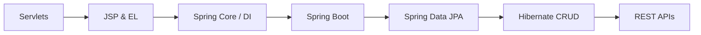

<div align="center">

# ☕ Java Backend Engineering Journey

### From Servlets & JSP → Spring Core → Spring Boot, JPA, Hibernate & REST APIs

*A hands-on, project-per-concept portfolio documenting my path to becoming a production-ready Java backend developer.*


</div>

---

## 📌 About This Repository

This repository contains **19 focused projects**, each built to master one specific backend concept. Instead of copy-pasting tutorials, every project is a small, runnable application where I implemented the concept, broke it, debugged it, and documented what I learned.

**The progression mirrors how real Java web frameworks evolved:**



Understanding *why* Spring Boot exists (by first building everything the hard way with raw Servlets and XML) gives me a much deeper grasp of what the framework does under the hood.

---

## 🧰 Tech Stack

| Layer | Technologies |
|---|---|
| **Language** | Java 17+ |
| **Web (Classic)** | Servlets, JSP, JSTL, Expression Language |
| **Frameworks** | Spring Framework (Core, DI), Spring Boot, Spring MVC |
| **Persistence** | JDBC, Hibernate ORM, Spring Data JPA |
| **Database** | MySQL / H2 |
| **Build Tool** | Maven |
| **Server** | Apache Tomcat (external + embedded) |
| **Tools** | Eclipse / STS, Postman, Git |

---

## 🗂️ Table of Contents

1. [Phase 1 – Servlets & JSP](#-phase-1--servlets--jsp-classic-java-web)
2. [Phase 2 – Spring Core](#-phase-2--spring-core-dependency-injection)
3. [Phase 3 – Spring Boot](#-phase-3--spring-boot--modern-backend)
4. [Skills Demonstrated](#-skills-demonstrated)
5. [How to Run Any Project](#-how-to-run-any-project)
6. [Roadmap](#-roadmap)
7. [Connect With Me](#-connect-with-me)

---

## 🌐 Phase 1 – Servlets & JSP (Classic Java Web)

> Building web applications from the ground up, so nothing about HTTP, the container, or the request lifecycle is a black box.

### 1. `Servers` — Web Server & Container Setup
- Configured **Apache Tomcat** and integrated it with the IDE
- Understood the difference between a **web server** and a **servlet container**
- Learned the `webapps` deployment structure (`WEB-INF`, `classes`, `lib`, `web.xml`)
- Port configuration, server start/stop lifecycle, and reading server logs

### 2. `ServletFirstDemo` — First Servlet
- Servlet **lifecycle**: `init()` → `service()` → `destroy()`
- Extending `HttpServlet` and overriding `doGet()` / `doPost()`
- A servlet is instantiated **once** and handles every request on a **separate thread** (thread-safety implications)
- Generating dynamic HTML using `PrintWriter` and `setContentType()`

### 3. `FirstDemo` — Fundamentals of a Dynamic Web App
- Project structure of a Dynamic Web Project and deployment descriptor basics
- Request → Container → Servlet → Response flow end-to-end

### 4. `Anno_Webxml_Demo` — Annotations vs `web.xml`
- Servlet mapping with `@WebServlet` vs `<servlet>` / `<servlet-mapping>` in `web.xml`
- Trade-offs: annotations (concise, co-located) vs XML (centralised, change without recompiling)
- `<load-on-startup>`, init parameters (`ServletConfig`) vs context parameters (`ServletContext`)

### 5. `RequestTheoryDemo` — HTTP Request Deep Dive
- **GET vs POST**: idempotency, data in URL vs body, caching, security implications
- `HttpServletRequest` APIs: `getParameter()`, `getParameterValues()`, `getHeader()`, `getMethod()`, `getRequestURI()`, `getQueryString()`
- Reading headers, cookies, and client info
- Handling form data and multi-valued parameters (checkboxes, multi-select)

### 6. `RequestDispatcherDemo` — Server-Side Forward & Include
- `forward()` — hands control to another resource; **URL does not change**, same request object
- `include()` — merges the output of another resource into the current response
- Sharing data across resources using `request.setAttribute()`

### 7. `sendRedirectDemo` — Client-Side Redirect
- `response.sendRedirect()` issues an HTTP **302**; browser makes a **new request** and the URL changes
- **Forward vs Redirect**: scope, request object, speed, and use-cases (the *Post/Redirect/Get* pattern to avoid duplicate form submissions)
- Redirecting to external URLs vs internal resources

### 8. `JSPdemo` — JavaServer Pages
- JSP lifecycle: translation → compilation → `_jspService()`
- Why JSP is *"a Servlet in disguise"*
- Implicit objects: `request`, `response`, `session`, `application`, `out`, `config`, `pageContext`
- Separating presentation (JSP) from logic (Servlet), the foundation of **MVC**

### 9. `ScriptingTagsDemo` — JSP Scripting Elements
- **Scriptlet** `<% %>`, **Expression** `<%= %>`, **Declaration** `<%! %>`
- **Directives**: `page`, `include`, `taglib`
- **Static vs Dynamic include** (`<%@ include %>` vs `<jsp:include>`)
- Why scriptlets are discouraged in modern code, motivating EL/JSTL

### 10. `ExpressionLanguageDemo` — EL (Expression Language)
- `${...}` syntax to access request, session, and application scope data cleanly
- Scope resolution order: page → request → session → application
- Implicit EL objects: `param`, `paramValues`, `header`, `cookie`, `sessionScope`, etc.
- Operators and null-safe property access, replacing verbose Java in JSP

### 11. `RegisterationDemo` — Full Mini-Application (Capstone of Phase 1)
- Complete **registration flow**: HTML form → Servlet → validation → database → response
- **JDBC** with `PreparedStatement` (prevents **SQL injection**)
- Server-side validation and error handling
- MVC-style separation of view, controller, and data access

---

## 🌱 Phase 2 – Spring Core (Dependency Injection)

> Moving from tightly coupled code to loosely coupled, testable architecture.

### 12. `com.learning` — Spring Fundamentals
- **Inversion of Control (IoC)** and the **IoC container** (`ApplicationContext`, `BeanFactory`)
- What a **bean** is and how Spring manages its lifecycle
- Configuration styles: XML, annotation-based, and Java-based (`@Configuration`, `@Bean`)
- Bean **scopes**: singleton vs prototype

### 13. `Spring_Autowiring_demo` — Annotation-Based Autowiring
- `@Component`, `@Service`, `@Repository`, `@Autowired`, `@Qualifier`, `@Primary`
- Dependency Injection types: **constructor** (recommended), **setter**, and **field** injection
- Resolving ambiguity when multiple beans of the same type exist
- `@ComponentScan` and stereotype annotations

### 14. `Spring_Autowiring_demo_XML` — XML-Based Autowiring
- Bean definition in `applicationContext.xml`
- Autowire modes: `byName`, `byType`, `constructor`
- Comparing XML vs annotation configuration, and why the industry moved to annotations

---

## 🚀 Phase 3 – Spring Boot & Modern Backend

> Convention over configuration: production-grade applications with minimal boilerplate.

### 15. `elite_first` — First Spring Boot Application
- Project bootstrapping with **Spring Initializr**
- `@SpringBootApplication` = `@Configuration` + `@EnableAutoConfiguration` + `@ComponentScan`
- Embedded Tomcat, `application.properties`, and the starter dependency model

### 16. `SpringBootProject_CompleteTutorial` — End-to-End Spring Boot
- Layered architecture: **Controller → Service → Repository**
- Spring MVC: `@Controller`, `@RequestMapping`, `@GetMapping`, `@PostMapping`
- `@RequestParam`, `@PathVariable`, `@RequestBody`
- Auto-configuration, profiles, externalised configuration, and logging

### 17. `SpringBootProject_Data_JPA` — Spring Data JPA
- Entities: `@Entity`, `@Table`, `@Id`, `@GeneratedValue`, `@Column`
- `JpaRepository` / `CrudRepository`: CRUD with **zero boilerplate**
- **Derived query methods** (`findByNameAndCity`) and custom `@Query` (JPQL / native)
- Pagination and sorting with `Pageable`

### 18. `SpringBootProject_HIBERNATE_CRUD` — Hibernate ORM
- **ORM concept**: mapping Java objects to relational tables
- `SessionFactory`, `Session`, transactions, and entity lifecycle states (*transient, persistent, detached*)
- Entity **relationships**: `@OneToOne`, `@OneToMany`, `@ManyToOne`, `@ManyToMany`
- **Lazy vs Eager loading**, and the N+1 query problem
- `ddl-auto` strategies and `@Transactional`

### 19. `SpringBootProject_RESTAPI` — RESTful Web Services ⭐
- `@RestController`, `ResponseEntity`, and proper **HTTP status codes** (200, 201, 204, 400, 404, 500)
- REST principles: statelessness, resource-based URLs, correct use of GET / POST / PUT / PATCH / DELETE
- **JSON** serialisation/deserialisation with Jackson
- **DTO pattern** to decouple API contracts from entities
- Input validation (`@Valid`, Bean Validation) and **global exception handling** (`@ControllerAdvice`)
- Tested end-to-end with **Postman**

#### Example endpoints

| Method | Endpoint | Description | Success Code |
|---|---|---|---|
| `GET` | `/api/resources` | Fetch all | `200 OK` |
| `GET` | `/api/resources/{id}` | Fetch one | `200 OK` |
| `POST` | `/api/resources` | Create | `201 Created` |
| `PUT` | `/api/resources/{id}` | Update | `200 OK` |
| `DELETE` | `/api/resources/{id}` | Delete | `204 No Content` |

---

## 🎯 Skills Demonstrated

| Area | What I Can Do |
|---|---|
| **Core Java Web** | Explain and implement the full request lifecycle, sessions, forward vs redirect |
| **Design Principles** | IoC, Dependency Injection, MVC, layered architecture, DTO pattern |
| **Spring Ecosystem** | Spring Core, Boot, MVC, Data JPA, auto-configuration |
| **Persistence** | JDBC → Hibernate → Spring Data JPA, with a clear understanding of each abstraction level |
| **API Development** | Designing and building RESTful services with validation and error handling |
| **Security Awareness** | Prepared statements to prevent SQL injection, server-side validation |
| **Tooling** | Maven, Git, Postman, Tomcat, IDE debugging |

---

## ▶️ How to Run Any Project

**Prerequisites:** JDK 17+, Maven 3.8+, MySQL (for DB-based projects), Apache Tomcat 9/10 (Servlet/JSP projects)

```bash
# 1. Clone the repository
git clone https://github.com/<your-username>/java-backend-journey.git
cd java-backend-journey

# 2a. Spring Boot projects
cd 03-spring-boot/SpringBootProject_RESTAPI
mvn spring-boot:run
# App starts at http://localhost:8080

# 2b. Servlet / JSP projects
# Import as "Existing Maven/Dynamic Web Project" in Eclipse,
# then: Right-click → Run As → Run on Server (Tomcat)
```

> 🔧 **Database setup:** update `spring.datasource.url`, `username` and `password` in each project's `application.properties`.

---

## 🛣️ Roadmap

- [x] Servlets, JSP & EL
- [x] Spring Core & Dependency Injection
- [x] Spring Boot, Spring Data JPA & Hibernate
- [x] RESTful API development
- [ ] Spring Security with **JWT authentication**
- [ ] Unit & integration testing (**JUnit 5, Mockito**)
- [ ] **Swagger / OpenAPI** documentation
- [ ] **Microservices** with Spring Cloud
- [ ] **Docker** containerisation & CI/CD with GitHub Actions
- [ ] Caching with **Redis**, messaging with **Kafka**

---

## 🤝 Connect With Me

- 💼 LinkedIn: (https://www.linkedin.com/in/akshara-gupta-b47231334)
- 📧 Email: gakshara21@gmail.com
- 🐙 GitHub: https://github.com/akshara2006-psit

---

<div align="center">

⭐ **If you found this repository useful, consider giving it a star!** ⭐

*Built with curiosity, one concept at a time.*

</div>
